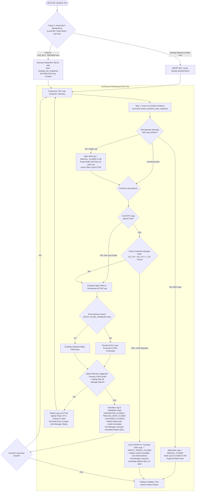

# Strategy Cycle Exit Architecture & Decision Tree

> ⚠️ **CRITICAL ARCHITECTURAL LOCK - DO NOT MODIFY WITHOUT EXPLICIT SECOND-ROUND USER APPROVAL**  
> This specification defines the foundational safety, entry idempotency, and exit decision logic for both **Tuesday (5-day)** and **Thursday (3-day)** F&O strategy cycles.  
> **Mandatory Rule for AI Assistants & Operators**: No future plan, prompt, or architectural refactor may alter, bypass, re-introduce pre-authorizations, or restructure the decision tree in this document without explicitly stating the proposed modification and obtaining **second-round confirmation** from the user.

---

## 1. Core Architectural Rules

### Rule 1: Single BUY Idempotency (Never Repeat at 10:02 AM or Subsequent Iterations)
* **Principle**: Once a paired BUY order is executed at 09:32 AM, the cycle is permanently recorded. The bot will **never** place another BUY order for the same cycle, regardless of how many times the collector cron runs (e.g. 10:02 AM, 10:32 AM).
* **Deterministic Ground Truth Verification**:
  1. **SQLite Database**: Table `strategy_buy_snapshots` is checked for `week_start_date = today_str`. If `entry_status` is `FILLED`, `PAPER_ENTRY`, or `COMPLETED`, entry is strictly aborted.
  2. **Broker Order Book**: `fetch_normalized_orders()` scans for existing BUY orders tagged `TUE-BUY` or `THU-BUY` with status `complete`, `filled`, `open`, or `trigger pending`. If present, entry is strictly aborted.
  3. **Broker Portfolio Exposure**: `fetch_broker_positions()` verifies net long quantities. If either `call_net > 0` or `put_net > 0`, entry is strictly aborted.
* **No Redis Flag Workarounds**: The old practice of flipping `LIVE_BUY_TRIGGER_* = false` on order fill and using a 10:15 / 15:45 cron (`reset_daily_buy_triggers.py`) to re-arm is **permanently eliminated**. `LIVE_BUY_TRIGGER_*` stays statically `true` in Redis/.env.

---

### Rule 2: Dual-Tier Exit Hierarchy (20% Combined Strangle Peak vs. Alpha FSM)
* **Tier 1 — Portfolio-Level 20% Combined Strangle Target (`PROFIT_TARGET_20PCT`)**:
  - Evaluated **first** across the combined strangle premium:
    $$\text{Combined LTP} = \text{CE\_LTP} + \text{PE\_LTP} \ge 1.20 \times (\text{CE\_entry} + \text{PE\_entry})$$
  - **Condition**: Only valid when **both legs are currently ACTIVE**.
  - **Action**: If reached, **both legs are SOLD immediately** via market orders. Both legs transition to `PROFIT_TARGET_CLOSED` in Alpha FSM state, and the cycle is marked `closed`.
* **Tier 2 — Alpha FSM Leg-by-Leg Execution**:
  - If the 20% portfolio target is not triggered (or if one leg has already exited), Alpha FSM is the **sole decision maker** for each active leg independently:
    - **Harvest (+50% profit or extrinsic risk covered)**: Transitions leg to `HARVESTED_CLOSED` $\rightarrow$ Immediate Market Sell.
    - **Dynamic Trailing Stop**: Ratchets upward with `peak_ltp` (25% Tue/Wed, 18% Thu/Fri, 10% Mon). If LTP falls below trailing stop $\rightarrow$ transitions to `TRAILING_STOP_CLOSED` $\rightarrow$ Immediate Market Sell.
    - **Salvage Stop**: Prevents runaway losses on the losing leg $\rightarrow$ transitions to `SALVAGED_CLOSED` $\rightarrow$ Immediate Market Sell.

---

### Rule 3: Absolute Exit Authorization Gating (Zero Unauthorized SELLs)
* **Zero Pre-Authorizations**: When orders are placed at 09:32 AM or registered manually, **NO** exit authorization keys are created in Redis.
* **Sole Exit Gate**: Exit managers (`Tuesday-Fno-Exit-Orders-V1.py` / `Thursday-Fno-Exit-Orders-V1.py`) require a real-time key in Redis:
  `fno:{broker}:enabled:{cycle}:{expiry}:{strike}:{option_type}` with value `{"quantity": Q, "mode": "immediate", "timestamp": ...}`.
* **Skip Without Authorization**: If this key does not exist for an open contract, the exit manager reports `authorization_skipped` and **places no broker orders**.
* **Authorized Publishers Only**: The ONLY code components permitted to write this key are:
  1. Alpha FSM exit transition (`publish_exit_authorization_to_redis()`).
  2. 20% Strangle Profit Target Monitor (`record_exit_signal_and_sync_mongo()`).
* **No Alternative Bypasses**: The `--exit-immediately` CLI flag and `EXIT_IMMEDIATELY_*` Redis keys are completely removed.

---

### Rule 4: Pivot Signals as Secondary Advisory Acceleration
* **Role**: Parallel advisory system evaluating spot Nifty against daily Pivot Points (R1, R2, S1, S2).
* **Secondary & Optional**: Controlled by `PIVOT_ACCEL_ENABLED` (defaults to `False`).
* **Behavior**:
  - When disabled (`False`): Operates in pure **shadow telemetry mode** (logs counterfactual suggestions to Redis/logs without modifying FSM decisions).
  - When enabled (`True`): Informs Alpha FSM when spot enters resistance/support zones to tighten salvage/harvest thresholds slightly faster.
  - The core state machine and trailing math remain **strictly inside Alpha FSM**.

---

### Rule 5: User Manual Single-Leg SELL Reconciliation
* **Operator Manual Action Respected**: The operator frequently monitors positions and may manually sell one leg via the broker app (e.g. Upstox mobile/web).
* **Automatic Detection**:
  - The auto-reconciler (`scripts/auto_record_manual_exit.py`) and periodic collector runs check live broker positions.
  - When the broker position for a contract becomes flat (net qty = 0) while Alpha FSM has it as `ACTIVE`:
    1. Verifies exact contract identity match (same strike, expiry, and broker).
    2. Identifies the manual sell trade in the broker order book to extract exact fill price, timestamp, and quantity.
    3. Updates SQLite DB and snapshot state: that leg becomes `MANUAL_CLOSED` with realized P&L.
    4. Purges any Redis authorization keys and trailing state keys for that leg.
* **Remaining Leg Monitoring**:
  - The other leg remains `ACTIVE`.
  - Alpha FSM continues evaluating tick-by-tick market conditions for the surviving leg.
  - The 20% combined strangle target is automatically **suppressed** because one leg is closed (`both_legs_active == False`).

---

### Rule 6: User Manual Both-Legs SELL / Double-Exit Safety
* **Full Manual Square-Off**: If the operator manually sells **both legs** (or if the 20% target closes both legs):
  1. Both legs transition to terminal state (`MANUAL_CLOSED` or `PROFIT_TARGET_CLOSED`).
  2. The cycle is marked `closed` in `strategy_buy_snapshots` and `active_strategies.json`.
  3. All authorization keys and trailing state keys for both legs are purged from Redis.
* **Double-Exit Safety**:
  - Alpha FSM and background monitors continue running for telemetry and logging.
  - Because broker net positions are 0 and legs are terminal, **no real broker orders will ever be placed again**.
  - The 20% profit logic will never attempt to re-exit already closed positions.

---

## 2. Complete Cycle Exit Decision Tree



---

## 3. Component Responsibility Matrix

| Component | Responsibility | Order Placement Ability |
|---|---|---|
| **`weekly_option_collector.py` / `thursday_option_collector.py`** | Performs paired BUY at 09:32 AM with strict DB & broker idempotency checks; runs broker auto-reconciliation; runs Alpha FSM tick evaluations. | Places **BUY** orders only (at 09:32 AM). Never places SELL orders directly. |
| **`common/entry_order_manager.py`** | Enforces `check_duplicate_entry_guard()` across SQLite `strategy_buy_snapshots`, broker order book tags, and broker net positions. | None (Guard only). |
| **`common/fsm_strategy.py`** | Pure decision engine. Evaluates tick prices against dynamic trailing stop, salvage, harvest, and pivot zones. Updates FSM state. | None (Emits state transitions only). |
| **`common/profit_monitor.py`** | Monitors combined strangle profit against +20% threshold. If reached while both legs are active, initiates full strangle closure. | Authorizes exit in Redis; delegates actual order execution to exit manager. |
| **`scripts/auto_record_manual_exit.py`** | Ground truth position reconciler. Detects operator manual broker fills, updates SQLite DB to `MANUAL_CLOSED`, purges Redis authorization and trailing keys. | None (Reconciler only; never places orders). |
| **`Tuesday-Fno-Exit-Orders-V1.py` / `Thursday-Fno-Exit-Orders-V1.py`** | Pure execution executor. Inspects live broker positions and Redis authorization keys. When `_redis_mode == "immediate"`, executes market sell. | Places **MARKET SELL** orders for authorized legs only. Cancels orphan orders. |
| **`scripts/cycle_pl_monitor.py`** | Read-only per-cycle P&L monitor. Displays real-time breakdown of open/sold legs, entry prices, exit prices, and realized/unrealized P&L. | **Strictly Read-Only**. Never writes to DB/Redis; never places orders. |

---

## 4. Codebase Alignment Verification

The current codebase has been verified against all 6 rules:

1. **Rule 1 (BUY Idempotency)**: Verified in `common/entry_order_manager.py:check_duplicate_entry_guard()` and `strategies/weekly_option_collector.py:515-590`. Verified by unit tests in `tests/test_daily_buy_triggers_and_idempotency.py`.
2. **Rule 2 (Dual-Tier Exit Hierarchy)**: Verified in `common/profit_monitor.py:560-633` (20% strangle lock) and `common/fsm_strategy.py:340-550` (Alpha FSM leg exits). Verified by unit tests in `tests/test_profit_target_exit.py`.
3. **Rule 3 (Absolute Exit Authorization Gating)**: Verified in `scripts/Tuesday-Fno-Exit-Orders-V1.py:1320-1350` and `scripts/Thursday-Fno-Exit-Orders-V1.py:1480-1510`. Unauthorized legs receive `authorization_skipped`. Pre-authorizations in `register_manual_entry.py` are removed.
4. **Rule 4 (Pivot Advisory)**: Verified in `common/fsm_strategy.py:258` (`pivot_accel_enabled: bool = False`) and `config.py`. Shadow telemetry active; live acceleration only if explicitly enabled. Verified by unit tests in `tests/test_fsm_pivot_acceleration.py`.
5. **Rule 5 (Single Leg Manual Exit)**: Verified in `scripts/auto_record_manual_exit.py:180-310`. Exact contract identity match (`strike`, `expiry`, `broker`) prevents false cross-track misattributions. The active surviving leg remains under Alpha FSM. Verified by unit tests in `tests/test_broker_manual_exit_reconciliation.py`.
6. **Rule 6 (Both Legs Manual Exit)**: Verified in `scripts/auto_record_manual_exit.py:360-375` (`both_legs_closed` marks cycle `closed` in DB). Exit managers and 20% profit monitor detect zero net position / closed cycle and suppress duplicate broker orders.

---

## 5. Operator Quick Reference

### Checking Cycle State on the VM
```bash
# 1. Inspect Alpha FSM state in local DB
jq '.alpha_fsm' /home/ubuntu/sqlite/strategies/current_week_buy.json

# 2. View Real-Time Read-Only P&L Monitor
cd /home/ubuntu/nifty50_strategies
.venv/bin/python scripts/cycle_pl_monitor.py --tuesday --table

# 3. Check for any active exit authorization keys in Redis (Should be EMPTY while trades are running normally)
redis-cli --scan --pattern "fno:*:enabled:*"

# 4. Trigger Instant Manual Reconciliation (if you manually sold on Upstox app and want immediate DB sync)
.venv/bin/python -c "from scripts.auto_record_manual_exit import reconcile_broker_positions_with_snapshot; reconcile_broker_positions_with_snapshot('5day_strategy')"
```
